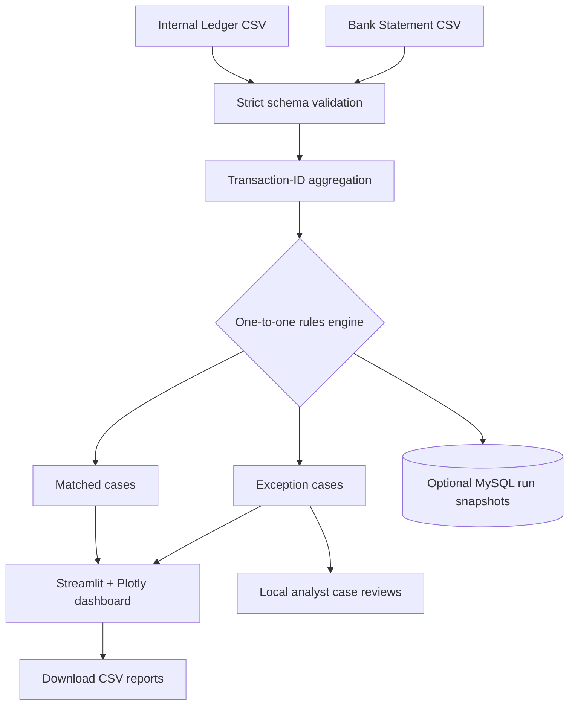

# FinRecon — Financial Operations & Reconciliation Dashboard

**Python · Pandas · MySQL · Streamlit · Plotly · Pytest**

An end-to-end portfolio project that reconciles an internal payments ledger with a bank statement, detects operational breaks, surfaces control metrics, and provides an analyst exception-review workflow. Built for beginner-to-intermediate data/finance roles.

> **Data safety:** All bundled transactions, counterparties, transaction IDs, and amounts are synthetically generated. This is a demonstrator, not production banking or accounting software.

## Project results (seed 42; 5,000 base transactions)

| KPI | Demo value |
| --- | ---: |
| Base ledger transactions | 5,000 |
| Ledger rows (including duplicates) | 5,020 |
| Bank rows | 4,990 |
| Unique reconciliation cases | 5,060 |
| Matched cases | 4,720 |
| Exceptions | 340 |
| Ledger match rate | **94.40%** |

The demo deliberately includes **missing bank entries, unexpected bank entries, amount mismatches, currency mismatches, delayed postings, and duplicate IDs**. Values and counts are reproducible with `--seed 42`.

## Features

- **Pandas reconciliation:** exact transaction-ID join; signed integer-pence matching; currency check; configurable calendar-day posting window; deterministic rule precedence.
- **Duplicate protection:** repeated transaction IDs on either side are isolated *before* comparing values. No accidental many-to-many matches.
- **Quality validation:** required columns, dates, three-letter currency codes, integer minor-unit amounts, unique bank row IDs, and missing identifiers.
- **Streamlit dashboard:** key finance KPIs, interactive Plotly plots, filters, CSV uploads/exports, and exception queue.
- **Case workflow:** assign a local `Open` / `Investigating` / `Resolved` review status and notes without changing the true reconciliation result.
- **Optional MySQL:** persist each reconciliation as a separate historical snapshot with source entries and the resulting cases. Run prepared SQL queries in MySQL Workbench.
- **Automated tests and CI:** pytest coverage of mismatches, duplicate traps, strict validation, deterministic data generation and local case-review updates.

## Dashboard preview — what it shows

1. KPI tiles for **ledger rows**, **matched**, **exceptions**, **match rate**, and **gross matched GBP value**.
2. Plotly **classification**, **weekly exceptions**, and **priority** charts.
3. Exception investigation queue with a searchable case-review form.
4. Download buttons for the raw datasets, full case file, and filtered exception file.
5. Opt-in MySQL storage and historical run summaries.

## Architecture



## Quick start — macOS (also works on Windows/Linux)

**Requirements:** Python 3.11–3.13 and Terminal. MySQL 8.0+ is optional.

```bash
# 1. Clone or download and unzip the repository
cd finrecon-github

# 2. Create an isolated environment
python3 -m venv .venv
source .venv/bin/activate

# 3. Install the application packages
python -m pip install -r requirements.txt

# 4. Launch the dashboard (no MySQL needed)
streamlit run app.py
```

Your browser should open to `http://localhost:8501`. If you cloned the repo with a different folder name, `cd` into that folder instead. On Windows, activate with `.venv\Scripts\activate`.

### CLI: generate a fresh dataset and export results

```bash
python -m finrecon.cli generate --count 5000 --seed 42
python -m finrecon.cli reconcile
```

Outputs are written to `data/ledger.csv`, `data/bank_statement.csv`, and `outputs/reconciliation_cases.csv` (the last file is gitignored). To change the allowed posting difference:

```bash
python -m finrecon.cli reconcile --date-tolerance 3
```

### Optional: connect MySQL Workbench

1. Start a local **MySQL 8+ server**. Note that Workbench is the client; it does not itself run the server.
2. Copy `.env.example` to `.env` and edit user/password/host/port. `.env` is gitignored.
3. Use either the **MySQL history** tab in the app to save a run, or execute:

```bash
cp .env.example .env
# Edit .env with your own credentials before proceeding.
python -m finrecon.cli reconcile --save-mysql
```

The program creates a `finrecon` database (unless `MYSQL_DATABASE` says otherwise), creates the schema from `sql/schema.sql`, and inserts an immutable snapshot of the raw ledger rows, bank rows, and classified cases. Your MySQL user needs database creation privileges the first time. Afterwards, open **`sql/analysis_queries.sql`** in Workbench and run the sample queries.

**Note:** Nothing is sent to MySQL unless you explicitly click **Save this reconciliation to MySQL** or pass `--save-mysql`.

## How matching works

One case is produced per distinct transaction ID. All comparisons use signed integer `amount_pence`, not floating-point currency values.

**Precedence (first matching rule wins):**

| Priority | Classification | Rule |
| --- | --- | --- |
| 1 | `duplicate_both` | More than one ledger row and more than one bank row for the same transaction ID |
| 2 | `duplicate_ledger` | More than one ledger row for the same transaction ID |
| 3 | `duplicate_bank` | More than one bank row for the same transaction ID |
| 4 | `unexpected_bank` | ID only appears in bank statement |
| 5 | `missing_bank` | ID only appears in ledger |
| 6 | `currency_mismatch` | Both sides appear once, but currency codes differ |
| 7 | `amount_mismatch` | Same ID/currency but signed amounts differ by ≥1 pence |
| 8 | `date_mismatch` | Same ID/currency/amount but date gap exceeds selected calendar-day tolerance |
| 9 | `matched` | ID, currency, exact amount and date all pass |

For IDs with duplicates, comparison amounts are marked **null** rather than showing the first ambiguous amount as definitive. `amount_difference_pence` is **bank minus ledger**, defined only for one-to-one records in the same currency. `date_lag_days` is **posting date minus ledger date**; negative values are allowed.

**Match rate denominator:** number of unique ledger transaction IDs; not bank-only case count or raw ledger row count. Thus an unexpected bank entry raises the exception count, but does not directly change the match-rate denominator. This is a consciously chosen operations KPI—not a general accounting balancing ratio.

**Money aggregation:** Only the **absolute values of matched GBP ledger transactions** are summed for the matched-volume KPI; other currencies are not silently combined or converted. Refunds retain their negative sign for matching.

## Project structure

```text
finrecon-github/
├── app.py                         # Streamlit user interface
├── finrecon/
│   ├── cli.py                     # Python command-line interface
│   ├── io.py                      # Input validation and CSV loading
│   ├── generator.py               # Deterministic synthetic transactions
│   ├── reconciliation.py          # Core matching & exception logic
│   ├── metrics.py                 # KPI definitions
│   ├── reviews.py                 # Local investigator notes/status
│   └── database.py                # Optional MySQL snapshots
├── data/
│   ├── ledger.csv                 # Bundled synthetic internal ledger
│   └── bank_statement.csv         # Bundled synthetic bank file
├── docs/
│   └── PROJECT_OVERVIEW.md        # Business context and limitations
├── sql/
│   ├── schema.sql                 # MySQL tables and indexes
│   └── analysis_queries.sql       # Example SQL for finance analysts
├── tests/                         # Automated unit tests
├── .github/workflows/tests.yml    # GitHub Actions (Python 3.11–3.13)
├── .streamlit/config.toml         # Dashboard appearance
├── .env.example                   # Sample non-secret DB config
├── requirements.txt
├── requirements-dev.txt
├── .gitignore
└── LICENSE
```

## Tests

```bash
python -m pip install -r requirements-dev.txt
python -m pytest -q
```

The CI workflow repeats these tests on GitHub pushes and pull requests. MySQL is **not required** for the unit tests; optional database integration is exercised manually against a local MySQL server.

## CSV contract (you can replace the synthetic inputs)

**`ledger.csv`**

| Column | Example | Description |
| --- | --- | --- |
| `transaction_id` | `TXN-0000001` | Reconciliation key; duplicates are exceptions |
| `transaction_date` | `2026-01-01` | YYYY-MM-DD |
| `amount_pence` | `250000` | Signed minor units; £2,500.00 |
| `currency` | `GBP` | Three-letter currency code |
| `counterparty` | `Northstar Retail Ltd` | Fictional business name |
| `reference` | `INV-34912` | Ledger reference for investigation |

**`bank_statement.csv`**

| Column | Example | Description |
| --- | --- | --- |
| `bank_entry_id` | `BNK-0000001` | Unique source-bank row identifier |
| `transaction_id` | `TXN-0000001` | Exact join key; duplicates reveal double posting |
| `posting_date` | `2026-01-02` | YYYY-MM-DD |
| `amount_pence` | `250000` | Signed minor units |
| `currency` | `GBP` | Three-letter currency code |
| `reference` | `INV-34912` | Bank reference for investigation |

**Input contract limitations:** both uploads must share the specified field names and populated transaction IDs. Bank-entry IDs cannot duplicate. Date differences use **calendar days** (not trading days); the project does not perform fuzzy reference matching, partial-payment matching, exchange-rate conversion, multi-line netting, or tolerance-based amount matching. It also does not connect to a real bank.

## Publish to GitHub

Create an **empty** GitHub repository named `financial-operations-reconciliation`, then from inside the extracted folder:

```bash
git init
git add .
git commit -m "Build financial operations reconciliation dashboard"
git branch -M main
git remote add origin https://github.com/YOUR-USERNAME/financial-operations-reconciliation.git
git push -u origin main
```

You must be signed into GitHub and have configured Git authentication. GitHub may ask for a browser authorization or token (not your GitHub password). Or simply upload the files through GitHub's **Add file → Upload files** interface while preserving their folders. Do not commit `.env` or private financial data.

### Deploying the dashboard

On [Streamlit Community Cloud](https://share.streamlit.io/), connect this GitHub repository and choose `app.py` as the entry point. The default demo and CSV uploads do **not** require MySQL. A local `127.0.0.1` MySQL server is not accessible from the hosted app; connecting a hosted database requires separate secure configuration and networking. Local investigator reviews are **ephemeral** on most cloud hosts.

## Resume / portfolio description

> Built a Python-based financial reconciliation dashboard to match over 5,000 synthetic payment transactions against bank records, automatically flag missing and duplicate entries, detect amount/currency/date mismatches, and visualize 340 seeded exceptions using Pandas, Plotly and Streamlit. Added optional MySQL snapshot storage, SQL analysis and automated testing.

*This line describes a self-built, synthetic-data project, not work experience with real customer funds.*

## Next enhancements

- Add business-day settlement calendars and cut-off time logic.
- Support partial settlements and controlled amount tolerances.
- Add role-based authentication, audited case changes, and persistent review storage.
- Add unit-aware multi-currency reports with sourced FX rates.
- Add a real reconciliation-run hash and immutable export for audit traceability.

**License:** MIT. See `LICENSE`.
